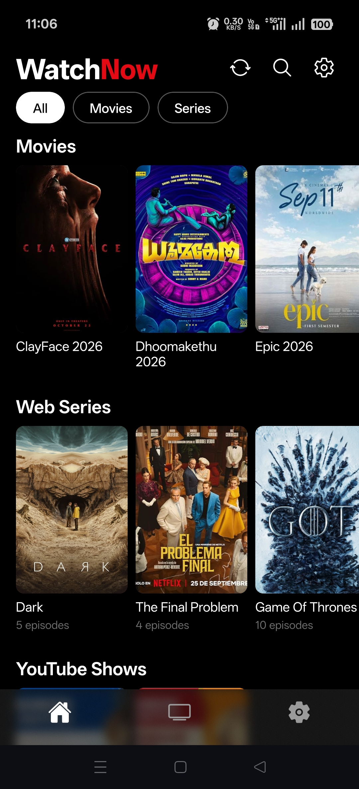
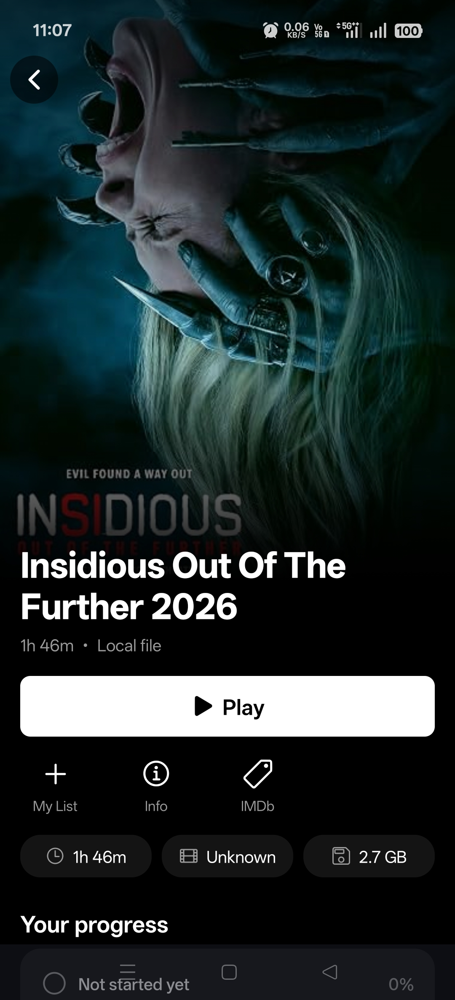
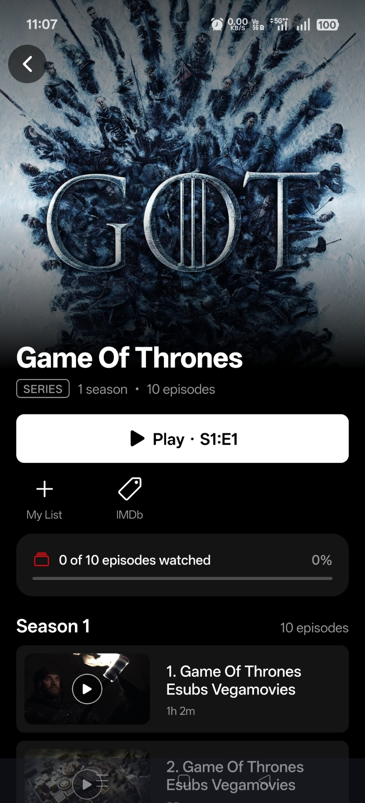
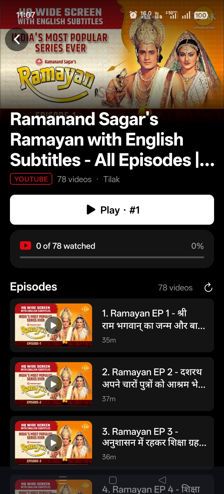
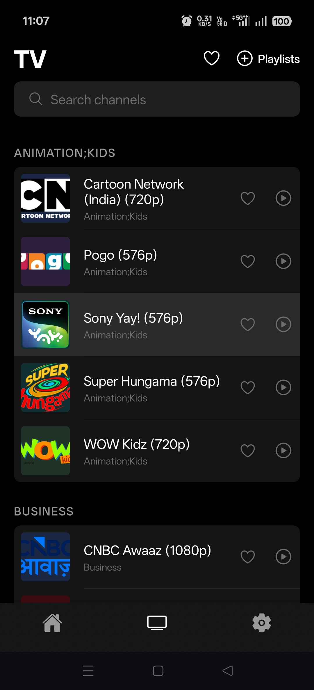
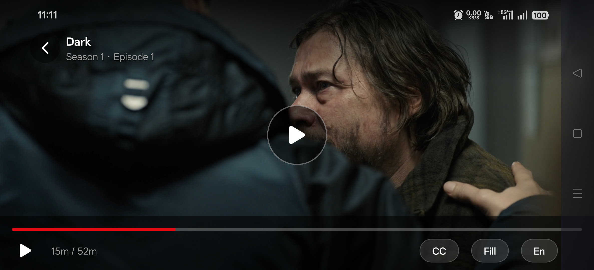
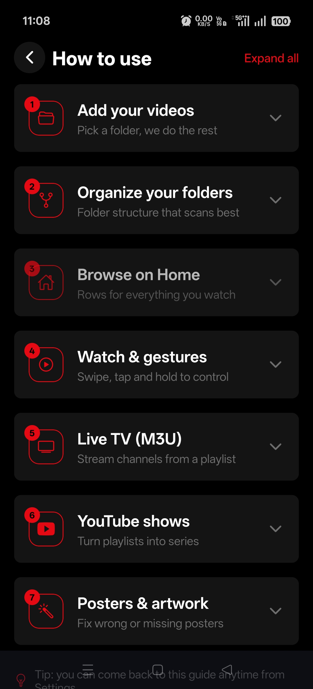
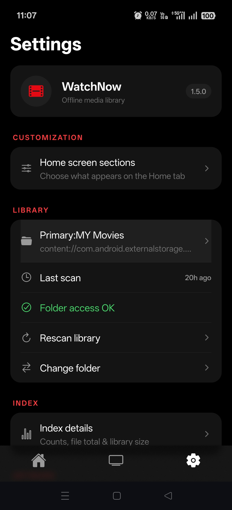

<p align="center">
  
</p>

<h1 align="center">WatchNow – Netflix-Style Video Player for Android</h1>

<p align="center">
  <b>Free, open-source Android media player</b> that scans your local movies and TV series, resumes where you left off, and streams <b>live TV (M3U/IPTV)</b> and <b>YouTube playlists</b> — all in one app.
</p>

<p align="center">
  <a href="https://github.com/ErManoj-Sharma/WatchNow/releases/latest"></a>
  
  
  
  
</p>

<p align="center">
  <b><a href="https://github.com/ErManoj-Sharma/WatchNow/releases/latest">⬇ Download the WatchNow APK</a></b>
</p>

---

## Table of Contents

- [What is WatchNow?](#what-is-watchnow)
- [Screenshots](#screenshots)
- [Features](#features)
- [Download & Install](#download--install)
- [App Details](#app-details)
- [FAQ](#faq)
- [Tech Stack](#tech-stack)
- [Build from Source](#build-from-source)
- [License](#license)

## What is WatchNow?

**WatchNow** is a free, open-source **offline video player and media library app for Android** with a Netflix-style interface. It automatically scans your phone or tablet for movies and TV series, fetches poster artwork and metadata, and organizes everything into a clean, dark-themed library with detail pages, season/episode lists, and a *Continue Watching* row.

Beyond local files, WatchNow also plays **live TV from M3U playlists (IPTV)** and **YouTube playlists** with episode tracking, so your whole watch list lives in one place.

Its **dual playback engine** uses `expo-video` for everyday files and automatically falls back to **libVLC** for formats and codecs Android can't play natively, such as **EAC3 / Dolby audio**.

## Screenshots

| Home                                                                                  | Movie                                                                                   | Series                                                                                 |
|---------------------------------------------------------------------------------------|-----------------------------------------------------------------------------------------|----------------------------------------------------------------------------------------|
|  |  |  |

| YouTube                                                                                   | Live TV                                                                        | Player                                                                                         |
|-------------------------------------------------------------------------------------------|--------------------------------------------------------------------------------|------------------------------------------------------------------------------------------------|
|  |  |  |

| How to use                                                             | Settings                                                     |
|------------------------------------------------------------------------|--------------------------------------------------------------|
|  |  |

## Features

### Local media library
- **Automatic library scan** – finds movies and series stored on your device, no manual sorting needed.
- **Poster artwork & metadata** from TMDB, TVmaze, and OMDb.
- **Favorites & My List** to bookmark what you want to watch next.

### Netflix-style experience
- Dark theme, movie and series detail pages, season/episode lists.
- **Continue Watching** rows with per-file progress.
- **Resume playback** – position is saved per file, and "Play · S1:E1" picks up where you stopped.

### Powerful video player
- **Dual playback engine** – `expo-video` for common files, automatic **libVLC fallback** for unsupported codecs (EAC3 / Dolby).
- **Subtitle and audio track picker** built into the player controls.

### Live TV & YouTube
- **Live TV / IPTV** – load your own **M3U playlists** and watch channels in-app.
- **YouTube playlists** – binge full series or playlists with episode tracking.

### Updates without the Play Store
- **In-app self-update** – download and install new APK versions directly from within the app.

## Download & Install

1. Go to the [**latest release**](https://github.com/ErManoj-Sharma/WatchNow/releases/latest).
2. Download the `.apk` file.
3. On your Android device, allow installs from your browser or file manager when prompted (**Install unknown apps**).
4. Open the APK and tap **Install**.

> WatchNow is distributed as a sideloaded APK via GitHub Releases. It is not on the Google Play Store.

## App Details

|                    |                                                                                      |
|--------------------|--------------------------------------------------------------------------------------|
| **Platform**       | Android 8.0+ (API 26)                                                                |
| **Package**        | `com.ermanojsharma.WatchNow`                                                         |
| **Version**        | 1.5.0                                                                                |
| **Size**           | See the [latest release](https://github.com/ErManoj-Sharma/WatchNow/releases/latest) |
| **Install method** | Sideload the APK from GitHub Releases                                                |
| **License**        | MIT                                                                                  |

## FAQ

**Is WatchNow free?**
Yes. WatchNow is free and open source under the MIT license.

**Does WatchNow work offline?**
Yes. Your local movie and series library plays fully offline. Artwork and metadata are fetched online when available, and live TV and YouTube need an internet connection.

**Can it play MKV files or videos with Dolby / EAC3 audio?**
Yes. If a file isn't supported by the default player, WatchNow automatically switches to the built-in **libVLC** engine.

**How do I watch live TV?**
Add your own **M3U playlist** in the Live TV section. WatchNow does not ship with any channels or playlists.

**Does it support subtitles and multiple audio tracks?**
Yes. The player has a built-in subtitle and audio track picker.

**Is there an iOS version?**
Not currently. WatchNow targets Android 8.0 and above.

**Why isn't it on the Play Store?**
It is distributed as an APK through GitHub Releases and updates itself in-app.

## Tech Stack

- [Expo SDK 57](https://docs.expo.dev/) · React Native 0.86 · TypeScript
- [Expo Router](https://docs.expo.dev/router/introduction/) – file-based navigation
- Native **libVLC** module (`modules/vlc-player/`) for codec fallback
- `expo-video` for primary playback
- `expo-sqlite` for library metadata · Reanimated for UI motion

## Build from Source

Requires **Node.js 20+** and the **Android SDK**.

```bash
git clone https://github.com/ErManoj-Sharma/WatchNow.git
cd WatchNow
npm install
npx expo run:android
```

> **Development build required.** WatchNow includes a custom native VLC module, so **Expo Go will not work**. Use `npx expo run:android` (local) or an [EAS development build](https://docs.expo.dev/develop/development-builds/introduction/).

## License

Released under the [MIT License](LICENSE).

---

<sub>Keywords: Android video player, offline media player, local video library, Netflix-style app, IPTV player, M3U player, live TV app, YouTube playlist player, VLC, libVLC, React Native, Expo, open source media center.</sub>